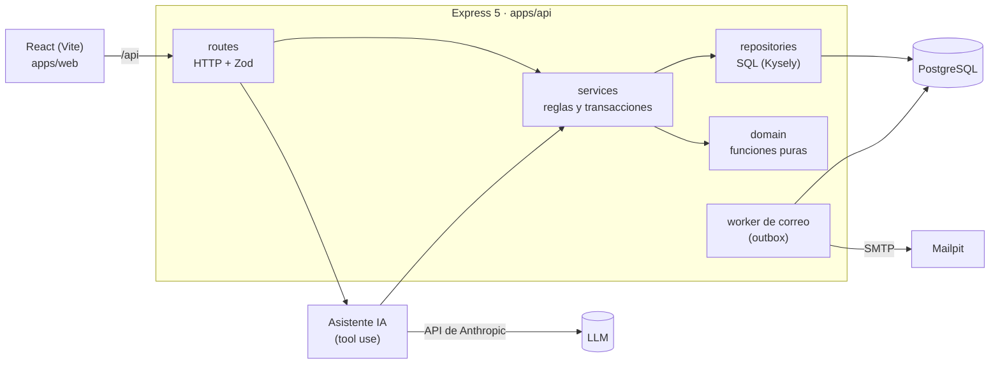

# Lumni Coworking · Reservas de salas

Prueba técnica Lumni TI. Monorepo TypeScript: React + Express + PostgreSQL.

## Cómo correrlo localmente

Requisitos: Node 20.11+ (ver `.nvmrc`), Docker.

```bash
cp .env.example .env
docker compose up -d
npm install
npm run db:migrate
npm run db:seed
npm run dev
```

- Web: http://localhost:5173
- API: http://localhost:3000/api/health
- Correos capturados (Mailpit): http://localhost:8025

Pruebas: `npm test`

## Usuarios de prueba

Creados por `npm run db:seed` (se puede correr varias veces sin duplicar nada).

| Rol       | Correo               | Contraseña   |
| --------- | -------------------- | ------------ |
| Cliente A | cliente.a@lumni.test | ClienteA123! |
| Cliente B | cliente.b@lumni.test | ClienteB123! |
| Admin     | admin@lumni.test     | Admin123!    |

El segundo cliente existe para demostrar que ni el API ni el asistente de IA muestran reservas de otro cliente.

Salas: Andes y Caribe (pequeñas, 4 personas), Pacífico y Amazonas (medianas, 8), Orinoco (grande, 16).

## Arquitectura



El front y el asistente usan **los mismos servicios**. Las garantías importantes (no hay doble reserva, un solo correo por reserva) son restricciones de PostgreSQL, así que ningún camino puede saltárselas.

**Capas del API** (cada módulo en `apps/api/src/modules/<módulo>/`):

| Capa              | Responsabilidad                                                           | No hace                |
| ----------------- | ------------------------------------------------------------------------- | ---------------------- |
| `*.routes.ts`     | HTTP: valida la entrada con Zod, toma la identidad de la sesión, responde | Reglas de negocio, SQL |
| `*.service.ts`    | Reglas de negocio y transacciones                                         | Conocer HTTP           |
| `*.repository.ts` | Consultas SQL con Kysely                                                  | Decidir reglas         |
| `domain/`         | Funciones puras: precios, máquina de estados, franjas, fechas relativas   | I/O, leer el reloj     |

**Estructura** (las carpetas se crean en el paso que las necesita):

```
apps/
  api/src/
    db/            cliente Kysely, migraciones, seed
    http/          middleware de errores y de autenticación
    modules/       auth, rooms, quotes, bookings, admin, emails, assistant
  web/src/         pantallas (cotizar, asistente de 3 pasos, admin, chat)
packages/
  shared/src/      esquemas Zod, tipos y constantes compartidas
```

## Decisiones

El enunciado deja vacíos; la regla es decidir, escribirlo y seguir. Estas son las decisiones tomadas.

| Vacío en el enunciado                                 | Decisión                                                                                                                           | Por qué                                                                                          |
| ----------------------------------------------------- | ---------------------------------------------------------------------------------------------------------------------------------- | ------------------------------------------------------------------------------------------------ |
| ¿La reserva debe terminar antes de las 21:00?         | Sí: inicio ≥ 7:00 y fin ≤ 21:00                                                                                                    | El horario de apertura es cuando se puede usar la sala                                           |
| Horas de inicio permitidas                            | En punto o y media (7:00, 7:30…)                                                                                                   | Coincide con bloques de 30 minutos y simplifica buscar el siguiente horario                      |
| Fechas y horas pasadas                                | Rechazadas; hoy solo con hora de inicio futura (hora de Bogotá)                                                                    | No se puede reservar el pasado                                                                   |
| Festivos                                              | Se ignoran (abre lunes a sábado aunque sea festivo)                                                                                | No está en el enunciado; requeriría una tabla de festivos                                        |
| Umbrales de descuento                                 | ≥ 4 h → 10 %, ≥ 8 h → 20 %, no acumulables                                                                                         | "Desde" es inclusivo                                                                             |
| Base del recargo                                      | 25 % sobre (base − descuento)                                                                                                      | Lo dice el enunciado; tiene prueba explícita                                                     |
| Precio de los extras (no dado)                        | Proyector 30.000 COP fijo por reserva; café 8.000 COP por persona                                                                  | Necesitan un número; están en un solo objeto de configuración                                    |
| ¿Descuento y recargo aplican a los extras?            | No: los extras se suman al final                                                                                                   | Lo más simple de explicar                                                                        |
| Qué reservas bloquean un horario                      | Confirmadas y completadas                                                                                                          | El enunciado dice "confirmada"; los borradores no bloquean                                       |
| "Siguiente horario disponible el mismo día"           | El primer inicio posterior al pedido, misma duración, que termine antes de las 21:00 y esté libre; si no hay, se dice              | "Siguiente" es después; evita sugerir el pasado                                                  |
| Cotización de un horario no reservable                | `200` con `bookable: false`, razones y precio; `400` solo si el formato es inválido                                                | Es una cotización válida de un horario inválido                                                  |
| Endpoints de salas y cotización                       | Públicos (no requieren sesión)                                                                                                     | Cotizar no cambia nada; reservar sí requiere sesión                                              |
| Sesión                                                | JWT HS256 de 8 horas en cookie `httpOnly`, `SameSite=Lax` (`Secure` en producción); el token solo lleva id y rol                   | JavaScript no puede leer la cookie; no hace falta guardar sesiones en el servidor                |
| ¿Cuántos borradores puede tener un cliente?           | Uno abierto. Volver a "Reservar" mueve ese borrador al nuevo horario (conserva datos de contacto, limpia extras, vuelve al paso 1) | "El borrador actual" debe ser uno solo; lo garantiza un índice único parcial en la base de datos |
| ¿Cuántas reservas confirmadas puede tener un cliente? | Sin límite; solo no puede haber dos confirmadas de la misma sala que se crucen                                                     | El enunciado no pone límite                                                                      |
| Moneda                                                | Pesos enteros, mostrados como $40.000                                                                                              | El enunciado usa COP sin decimales                                                               |

## API

| Método | Ruta               | Descripción                                                                                                                            |
| ------ | ------------------ | -------------------------------------------------------------------------------------------------------------------------------------- |
| GET    | `/api/rooms`       | Salas con tamaño, capacidad y tarifa por hora                                                                                          |
| POST   | `/api/auth/login`  | `{ email, password }` → `{ user }` y cookie de sesión `httpOnly`                                                                       |
| POST   | `/api/auth/logout` | Cierra la sesión (borra la cookie)                                                                                                     |
| GET    | `/api/auth/me`     | Usuario de la sesión, o `401`                                                                                                          |
| POST   | `/api/quotes`      | `{ roomId, date: 'AAAA-MM-DD', startTime: 'HH:mm', durationHours, extras? }` → desglose, `bookable`, razones y siguiente horario libre |

Errores: siempre `{ error: { code, message, details? } }`.

## Garantías de concurrencia

Las dos garantías que pide la prueba viven en PostgreSQL, no en revisiones en código: una revisión del tipo "¿está libre? → confirmo" tiene una condición de carrera (dos peticiones revisan al mismo tiempo, ninguna ve nada y las dos confirman).

### 1. Dos clientes confirman la misma sala y horario: solo uno gana

Restricción de exclusión en la tabla `bookings` (migración `0003`):

```sql
EXCLUDE USING gist (room_id WITH =, tstzrange(starts_at, ends_at, '[)') WITH &&)
  WHERE (status IN ('confirmed', 'completed'))
```

- No pueden existir dos reservas confirmadas de la misma sala con rangos que se crucen. PostgreSQL lo verifica de forma atómica: si dos confirmaciones llegan a la vez, la segunda espera a la primera y falla con `23P01`.
- El API traduce ese error a `409 SLOT_TAKEN` con el siguiente horario libre del mismo día.
- El rango es semiabierto (`[)`): 10:00–12:00 y 12:00–14:00 no chocan.
- Los borradores no bloquean: dos personas pueden tener borradores del mismo horario; gana quien confirme primero.

### 2. El mismo cliente confirma dos veces: sin duplicado y sin recalcular el precio

La confirmación es un `UPDATE` condicional que guarda el precio en la misma sentencia:

```sql
UPDATE bookings SET status = 'confirmed', confirmed_at = now(), base = …, total = …
WHERE id = $1 AND customer_id = $2 AND status IN ('draft')
RETURNING *;
```

- Si ya estaba confirmada, el servicio devuelve la reserva guardada con su precio, sin recalcular nada (`200`, idempotente).
- Si dos confirmaciones de la misma reserva llegan a la vez, se serializan en el bloqueo de la fila: la segunda vuelve a evaluar `status IN ('draft')`, no actualiza nada y recibe la reserva ya confirmada.
- El precio se calcula en el servidor al confirmar y queda congelado en la fila (`base`, `discount`, `surcharge`, `extras_total`, `total`); después nunca se recalcula.
- La misma condición protege la máquina de estados: una confirmación tardía no puede sobrescribir una cancelación (`409 INVALID_TRANSITION`).

### Cómo se prueba

Pruebas de integración contra PostgreSQL real (`bookings.confirm.test.ts`, `bookings.cancel.test.ts`). Para que "al mismo tiempo" no dependa de la suerte, `src/test/concurrency.ts` bloquea la fila, lanza las peticiones, espera a que PostgreSQL reporte que todas están bloqueadas en su `UPDATE` y las libera juntas. Para comprobar que las pruebas detectan errores, quité a propósito la condición `status IN (…)` de la confirmación y de la cancelación: las pruebas de carrera fallaron en cada corrida.

## Correo de confirmación en segundo plano

_Pendiente (Parte 2.1)._

## Asistente de reservas con IA

_Pendiente (Parte 2.2), incluida la regla 4._

## Qué quedó por fuera y por qué

_Pendiente._

## Uso de IA

_Pendiente: herramienta, en qué partes, un ejemplo corregido o descartado, qué verifiqué yo._
