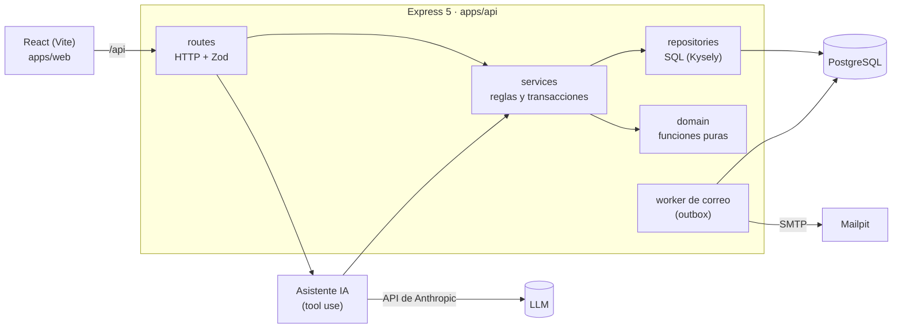

# Lumni Coworking · Reservas de salas

Prueba técnica Lumni TI. Monorepo TypeScript: React + Express + PostgreSQL.

## Cómo correrlo localmente

Requisitos: Node 20.11+ (ver `.nvmrc`), Docker.

```bash
cp .env.example .env
docker compose up -d
npm install
npm run db:migrate
npm run db:seed
npm run dev
```

- Web: http://localhost:5173
- API: http://localhost:3000/api/health
- Correos capturados (Mailpit): http://localhost:8025

Pruebas: `npm test`

## Usuarios de prueba

Creados por `npm run db:seed` (se puede correr varias veces sin duplicar nada).

| Rol       | Correo               | Contraseña   |
| --------- | -------------------- | ------------ |
| Cliente A | cliente.a@lumni.test | ClienteA123! |
| Cliente B | cliente.b@lumni.test | ClienteB123! |
| Admin     | admin@lumni.test     | Admin123!    |

El segundo cliente existe para demostrar que ni el API ni el asistente de IA muestran reservas de otro cliente.

Salas: Andes y Caribe (pequeñas, 4 personas), Pacífico y Amazonas (medianas, 8), Orinoco (grande, 16).

## Arquitectura



El front y el asistente usan **los mismos servicios**. Las garantías importantes (no hay doble reserva, un solo correo por reserva) son restricciones de PostgreSQL, así que ningún camino puede saltárselas.

**Capas del API** (cada módulo en `apps/api/src/modules/<módulo>/`):

| Capa              | Responsabilidad                                                           | No hace                |
| ----------------- | ------------------------------------------------------------------------- | ---------------------- |
| `*.routes.ts`     | HTTP: valida la entrada con Zod, toma la identidad de la sesión, responde | Reglas de negocio, SQL |
| `*.service.ts`    | Reglas de negocio y transacciones                                         | Conocer HTTP           |
| `*.repository.ts` | Consultas SQL con Kysely                                                  | Decidir reglas         |
| `domain/`         | Funciones puras: precios, máquina de estados, franjas, fechas relativas   | I/O, leer el reloj     |

**Estructura** (las carpetas se crean en el paso que las necesita):

```
apps/
  api/src/
    db/            cliente Kysely, migraciones, seed
    http/          middleware de errores y de autenticación
    modules/       auth, rooms, quotes, bookings, admin, emails, assistant
  web/src/         pantallas (cotizar, asistente de 3 pasos, admin, chat)
packages/
  shared/src/      esquemas Zod, tipos y constantes compartidas
```

## Decisiones

_Pendiente: tabla de ambigüedades y decisiones._

## Garantías de concurrencia

_Pendiente: doble reserva del mismo horario y doble confirmación de la misma reserva._

## Correo de confirmación en segundo plano

_Pendiente (Parte 2.1)._

## Asistente de reservas con IA

_Pendiente (Parte 2.2), incluida la regla 4._

## Qué quedó por fuera y por qué

_Pendiente._

## Uso de IA

_Pendiente: herramienta, en qué partes, un ejemplo corregido o descartado, qué verifiqué yo._
